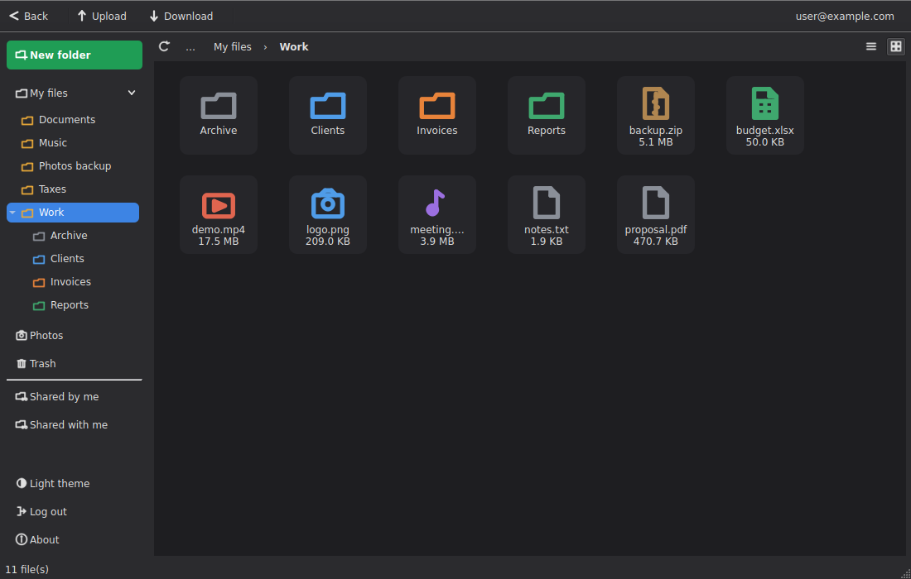

# Proton Drive GUI

A desktop window for Proton Drive on Linux. It runs on top of Proton's official
command-line client (`proton-drive`): the app doesn't reimplement any Proton
protocol and doesn't touch your login.

> **Not affiliated with Proton AG.** This is a third-party client.

> **Linux only.** Built and tested on Linux.

## What it does

- Browse My files with a folder tree in the sidebar; list or grid view
- Upload (button or drag and drop), download with progress, move, copy, rename
- Sort by name, size or date
- Copy, cut and paste; new folder and new file; move to Trash
- Trash: restore, delete permanently, empty trash
- Photos with real file names and sizes
- Folder sizes, folder colours and a cached folder list for faster opening
- Light and dark themes

The full list, with limitations, is in [docs/features.md](docs/features.md).

## Install

Pick one. Each needs the official `proton-drive` CLI as well.

- **Debian, Ubuntu, Linux Mint**: download the `.deb` from the
  [Releases page](https://github.com/al3xg0r/protondrive-gui/releases) and run
  `sudo apt install ./protondrive-gui_<version>_amd64.deb`. It also installs the
  official CLI, checked against Proton's SHA-512.
- **Any Linux**: download the AppImage from the
  [latest release](https://github.com/al3xg0r/protondrive-gui/releases/latest),
  make it executable and run it.
- **From source**: `./install.sh` installs the CLI and everything else in one go.

Step-by-step instructions, including the manual setup and building your own
packages, are in [docs/install.md](docs/install.md).

Log in once with `proton-drive auth login`, then start **Proton Drive GUI**.

## Documentation

- [Installing](docs/install.md)
- [Features](docs/features.md), including what data is kept on your computer
- [CLI notes](docs/cli.md): what the official CLI can and can't do
- [Roadmap](docs/roadmap.md)
- [Changelog](CHANGELOG.md)

## Contributing

Issues and pull requests are welcome. The GUI (`gui/main_window.py`) and the CLI
wrapper (`gui/cli.py`) are kept apart on purpose, so most changes touch only one
of them.

## Support Development

My open-source projects are built independently and remain accessible to everyone.

If you find these tools useful and would like to support their continued development, maintenance, and new features, you can support me on Patreon.

Every contribution helps me dedicate more time to building and improving open-source software.

[Support on Patreon](https://www.patreon.com/al3xg0r)

## License

[PolyForm Noncommercial 1.0.0](https://polyformproject.org/licenses/noncommercial/1.0.0).
Free for any noncommercial use, including personal, educational and nonprofit
use. Commercial use and resale are not allowed. Anyone redistributing the
software must keep the notice pointing back to this repository. See
[LICENSE](LICENSE) for the exact terms.

This is not an OSI-approved open-source license, because OSI's definition
requires allowing commercial use. This isn't legal advice; if it matters for
your situation, check with someone qualified.
